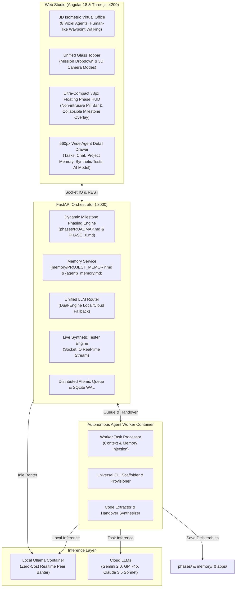

# 🏢 HAS AI STUDIO | Autonomous Multi-Agent Software Engineering Studio

[](docs/architecture-diagram.html)
[-purple.svg)](#-dual-engine-llm-routing)
[](#-accumulated-project-memory-engine)
[](#-live-synthetic-testing--verification)

**HAS AI STUDIO** is an advanced, localized, autonomous multi-agent software engineering studio. It provides a real-time **3D WebGL Virtual Office** where 8 specialized artificial intelligence agents collaborate, design architectures, write code, run live synthetic tests, and build complete software applications.

Powered by a **Dual-Engine LLM Architecture**, the system intelligently routes continuous informal peer banter to zero-cost local models (**Ollama**) while directing mission-critical planning and coding tasks to high-reasoning cloud or local LLMs (**Google Gemini 2.0 Flash/Pro**, **OpenAI GPT-4o**, **Anthropic Claude 3.5 Sonnet**).

---

## 🌟 Architectural Highlights



---

## 🚀 Key Features

### 1. 🏢 Interactive 3D AI Virtual Office (Claw3D Architecture)
- **Three.js WebGL Viewport**: High-performance 3D isometric studio running directly in the browser with full-bleed layout.
- **8 Dedicated Voxel Agents**: Complete with personalized 3D models, neon accent rings, dynamic human-like walking animations, and animated multi-monitor workstations.
- **Natural Human-like Walking & Autonomous Pathfinding**: Agents do not merely sit at desks or teleport; between tasks, they stand up and smoothly walk step-by-step across waypoints, relaxing on the lounge sofa, grabbing coffee at the espresso bar, chatting at the water cooler, brainstorming at the glass whiteboard, or playing retro arcade games.
- **3D Projected Billboard Overlays**: Dynamic speech bubbles and role tags follow agent positions across 3D coordinates in real time.
- **Multi-Perspective Camera Views**: Instant toggle between `3D ISO`, `SİNEMATİK` (low-angle dynamic), `KUŞBAKIŞI` (architectural blueprint), `WAR ROOM` table focus, and `LOUNGE` area focus.

### 2. 🧠 Dual-Engine LLM Architecture
- **Informal Office Banter Engine**: Automatically routes social chit-chat and reciprocal peer dialogues to local Ollama (`llama3.1:latest`, `qwen2.5-coder:7b`) with zero API costs.
- **Task Execution Engine**: Routes code writing, sprint planning, and architectural synthesis to high-intelligence cloud LLMs (**Gemini 2.0 Flash / Pro**, **GPT-4o**, **Claude 3.5 Sonnet**) or dedicated local code models.
- **Per-Agent & Global Configuration**: Configure chat and task models globally or individually via the agent detail drawer (`⚙️ AI Modeli` tab) or `data/config.json`.

### 3. 💬 Autonomous Reciprocal Multi-Turn Dialogues
- When two idle agents cross paths in an office social zone (Coffee Bar, Whiteboard, Water Cooler, Lounge, Arcade), Agent A initiates a contextual opening generated by the local LLM.
- Agent B receives Agent A's opening as a prompt and formulates a dynamic response.
- Witty 2-to-3 turn engineering banter streams live to 3D speech bubbles and the floating banter toast.

### 4. 📌 Project-Driven Multi-Agent Milestone Phasing
- **Interactive TeamLead Consultation**: Users discuss requirements with the TeamLead in the dashboard. When the blueprint matures, TeamLead requests explicit user approval (`[EVET, PROJEYİ BAŞLAT]`).
- **Work-Milestone Phasing (Not Rigid 1-Agent Ladders)**:
  - Phases are structured around project milestones and real deliverables rather than isolated individual agents.
  - Multiple agents collaborate simultaneously within the same phase (e.g., **Phase 1: Altyapı & Veritabanı Mimarisi** with `@DevOps` and `@Database`; **Phase 2: İş Mantığı & Web Arayüzü** with `@Backend` and `@Frontend`; **Phase 3: Güvenlik, Sentetik Testler & Teslimat** with `@Security`, `@Tester`, `@Documenter`, `@TeamLead`).
- **Standardized Dynamic Markdown (`phases/`)**:
  - `phases/ROADMAP.md`: High-level architectural roadmap, milestone summaries, and participating agents.
  - `phases/PHASE_X.md`: Granular tasks, deliverables, acceptance criteria, and live execution handover logs.
- **Ultra-Compact 38px Floating Phase HUD**:
  - Replaces bulky vertical blocks with an ultra-compact 38px floating glass pill bar (`👑 TEAMLEAD FAZ | FAZ X / Y | Project Name | 👥 @Agents | Commentary | % Progress | [ ▾ Faz Detayı ]`).
  - Expanding the HUD opens a sleek floating glass card overlaying the 3D canvas without squashing or resizing the Three.js viewport.

### 5. 🗂️ Wide 560px Agent Detail Drawer
- Expanding an agent opens an ergonomic **560px** glass sliding drawer with 5 segmented tabs:
  1. `📋 Görevler`: Detailed assigned tasks, current execution status, and file deliverables.
  2. `💬 Sohbetler`: Real-time dialogue log and agent social banter history.
  3. `🧠 Proje Hafızası`: Agent's specialized memory notes and cross-phase architectural decisions.
  4. `🧪 Canlı Testler`: Real-time synthetic test run logs and step-by-step verification results.
  5. `⚙️ AI Modeli`: Dual-Engine model switcher (Task LLM & Chat LLM independently selectable).

### 6. 🧠 Accumulated Project Memory Engine
- **Cross-Phase Collective Memory (`memory/`)**:
  - `memory/PROJECT_MEMORY.md`: Shared architectural decisions, API contracts, database schemas, and shared environment variables.
  - `memory/{agent}_memory.md`: Individual specialized memories (`teamlead_memory.md`, `backend_memory.md`, `frontend_memory.md`, etc.).
- **Automatic Context Injection**: When an agent begins a task, relevant project memory is pre-pended to the prompt.
- **Post-Task Memory Extraction**: Upon task completion, technical decisions and file paths are summarized and permanently saved to the project's memory repository.

### 7. 🧪 Live Synthetic End-to-End Testing & Verification
- Rather than running blind unit tests, the **Tester** agent executes synthetic user-journey test steps using [`core/services/live_tester.py`](file:///c:/Users/fatih/Desktop/apps/has-ai-team/core/services/live_tester.py).
- Each step streams live to the Web Studio via Socket.IO, displaying step name, pass/fail status, and execution duration in milliseconds.
- Visual alerts appear on the 3D canvas, and full step logs are cataloged in the agent detail drawer's `🧪 Testler` tab.

---

## 👥 The 8 Specialized AI Agents

| Agent | Role | Accent Color | Primary Responsibilities |
|---|---|:---:|---|
| **TeamLead** | Solution Architect | `#facc15` (Gold) | Requirements elicitation, user approval gate, roadmap & milestone phase generation (`phases/`), memory synthesis. |
| **DevOps** | Infrastructure Engineer | `#f97316` (Orange) | Environment provisioning, Dockerfiles, Compose setups, CI/CD scripts, package manager setup. |
| **Database** | Data Architect | `#14b8a6` (Teal) | Schema modeling, ORM entity definitions, migrations, seeders, indexing strategies. |
| **Backend** | API Engineer | `#10b981` (Emerald) | REST / GraphQL / WebSocket endpoints, business logic, authentication, middleware, service layer. |
| **Frontend** | UI/UX Developer | `#06b6d4` (Cyan) | Component architecture, responsive layouts, client routing, state management, API integration. |
| **Security** | Security Auditor | `#ef4444` (Red) | OWASP vulnerability scans, CORS & auth token verification, input sanitation, secret shielding. |
| **Tester** | QA & Synthetic Tester | `#a855f7` (Purple) | Live synthetic user journey tests, contract validation, regression checks, test reporting. |
| **Documenter** | Technical Writer | `#38bdf8` (Sky Blue) | OpenAPI specs, README generation, architecture documentation, changelogs, deployment manuals. |

---

## 📁 Repository Structure

```
has-ai-team/
├── apps/                         # Output directory for agent-generated codebases
├── client/                       # Angular 18+ Web Studio & Three.js 3D Office
│   ├── src/app/
│   │   ├── core/                 # Header, Sidebar, RightPanel, Global Guards
│   │   ├── features/
│   │   │   ├── active-projects/  # 3D Three.js Office (Claw3D Scene, Floating HUD, 560px Drawer)
│   │   │   ├── dashboard/        # TeamLead PO Conversation & Blueprint Launcher
│   │   │   ├── projects/         # Project & File Explorer
│   │   │   ├── reports/          # Team Reports & Handover Records
│   │   │   ├── execution-traces/ # Raw Agent LLM Execution Log Replay
│   │   │   └── settings/         # Node Registry & Hardware Diagnostics
│   │   └── services/             # Socket.IO & Orchestrator API Clients
├── core/                         # FastAPI Orchestration Engine
│   ├── routers/                  # API Endpoints (chat, sprint, phases, memory, llm)
│   ├── services/
│   │   ├── phase_service.py      # phases/ROADMAP.md & PHASE_X.md Milestone Management
│   │   ├── memory_service.py     # memory/PROJECT_MEMORY.md & Agent Memory State
│   │   ├── live_tester.py        # Live Synthetic Testing Engine
│   │   ├── unified_llm.py        # Dual-Engine Router (Ollama + Gemini/OpenAI/Claude)
│   │   └── worker_service.py     # Milestone Task Processor with Memory Injection
│   ├── config.py                 # System Configuration & Path Resolvers
│   ├── database.py               # SQLite WAL Engine & Session Management
│   └── schemas.py                # Pydantic Request/Response Models
├── data/                         # Persistent Storage (traceability.db, config.json)
├── docs/
│   └── architecture-diagram.html # Interactive Visual Architecture Diagram
├── memory/                       # Runtime Project Memory Storage
├── phases/                       # Project Phase Roadmaps & Specifications
├── prompts/                      # Specialized Persona Markdown Definitions
│   ├── teamlead/                 # Solution Architect Prompts & Chat Logic
│   ├── backend/                  # API Developer Personas
│   ├── frontend/                 # UI/UX Engineer Personas
│   └── ...
├── docker-compose.yml            # Multi-Container Deployment Specification
└── README.md                     # Studio Documentation
```

---

## 🏗 System Architecture Diagram

For an interactive HTML visual representation with vector diagrams and container networking maps, open [`docs/architecture-diagram.html`](docs/architecture-diagram.html).

---

## 📦 Installation & Setup

### Prerequisites
- [Docker](https://www.docker.com/) and [Docker Compose](https://docs.docker.com/compose/) (v2.20+)
- Modern Web Browser with WebGL support (Chrome, Edge, Firefox, Brave)
- *(Optional)* NVIDIA GPU with `nvidia-container-toolkit` for local GPU-accelerated Ollama inference.

### Quick Start

1. **Clone the repository:**
   ```bash
   git clone https://github.com/fathasss/has-ai-team.git
   cd has-ai-team
   ```

2. **Configure Cloud LLM Keys (Optional for Cloud Tasks):**
   Set your API keys as environment variables or configure them directly via the UI drawer:
   ```bash
   export GEMINI_API_KEY="your-gemini-key"
   # or
   export OPENAI_API_KEY="your-openai-key"
   ```

3. **Start the studio environment:**
   ```bash
   docker compose up -d --build
   ```
   *This initializes:*
   - `has-ai-ollama`: Local model inference server (`:11434`)
   - `has-ai-orchestrator`: FastAPI central orchestrator (`:8000`)
   - `has-ai-agent-worker`: Autonomous worker container with CLI tools
   - `has-ai-web-cli`: Angular 18 Web Studio served via Nginx (`:4200`)

4. **Access the 3D Studio:**
   Navigate to `http://localhost:4200` in your browser.

---

## ⚙️ Dual-Engine LLM Configuration

The studio allows seamless switching between local and cloud providers:

| Context | Recommended Provider | Model | Notes |
|---|---|---|---|
| **Office Idle Banter** | **Ollama** (Local) | `llama3.1:latest` | Zero-cost continuous dialogue generation between wandering agents. |
| **Sprint Tasks / Code** | **Google Gemini** | `gemini-2.0-flash` | High-speed, high-reasoning code generation, and architectural design. |
| **Sprint Tasks / Code** | **OpenAI** | `gpt-4o` / `gpt-4o-mini` | Advanced multi-file reasoning and complex refactoring. |
| **Sprint Tasks / Code** | **Anthropic** | `claude-3-5-sonnet` | Exceptionally strong frontend and system-level coding. |
| **Offline Code Tasks** | **Ollama** (Local) | `qwen2.5-coder:7b` | Completely air-gapped, zero-cloud software engineering. |

Configurations can be customized per-agent or applied to the whole team in the **Agent Detail Drawer (`⚙️ AI Modeli`)** or via `core/services/unified_llm.py`.

---

## 📡 REST API & Real-Time Endpoints

| Method | Endpoint | Description |
|---|---|---|
| `POST` | `/chat` | Conversational PO chat with TeamLead. |
| `POST` | `/chat/idle` | Generate informal peer dialogue turn between two agents in a specific zone. |
| `GET` | `/sprints` | List all available multi-agent sprints/missions. |
| `GET` | `/sprint/{sid}/phases` | Retrieve sequenced milestone phase status, deliverables, and assigned agents. |
| `GET` | `/sprint/{sid}/memory` | Retrieve cumulative project memory (`PROJECT_MEMORY.md` & agent notes). |
| `GET` | `/llm/routing` | Fetch global and per-agent LLM routing configurations. |
| `POST` | `/llm/routing/agent` | Save per-agent or team-wide Dual-Engine LLM assignments. |
| `GET` | `/metrics` | Hardware telemetry (CPU, RAM, Disk, GPU Utilization via `pynvml`). |

---

## 🛡 License & Credits

Developed with precision for the **HAS AI STUDIO**. All rights reserved.  
**Architect:** [@fathasss](https://github.com/fathasss)
